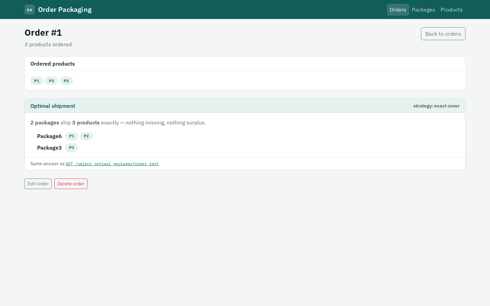
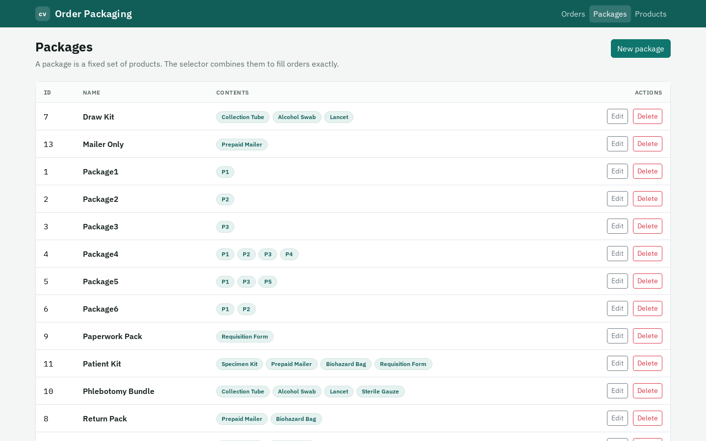
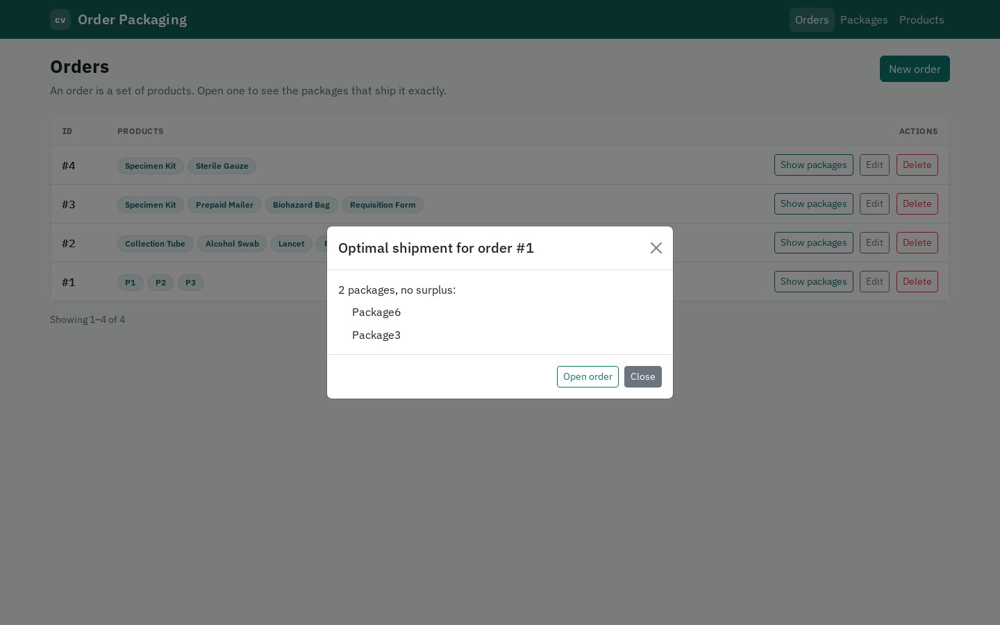
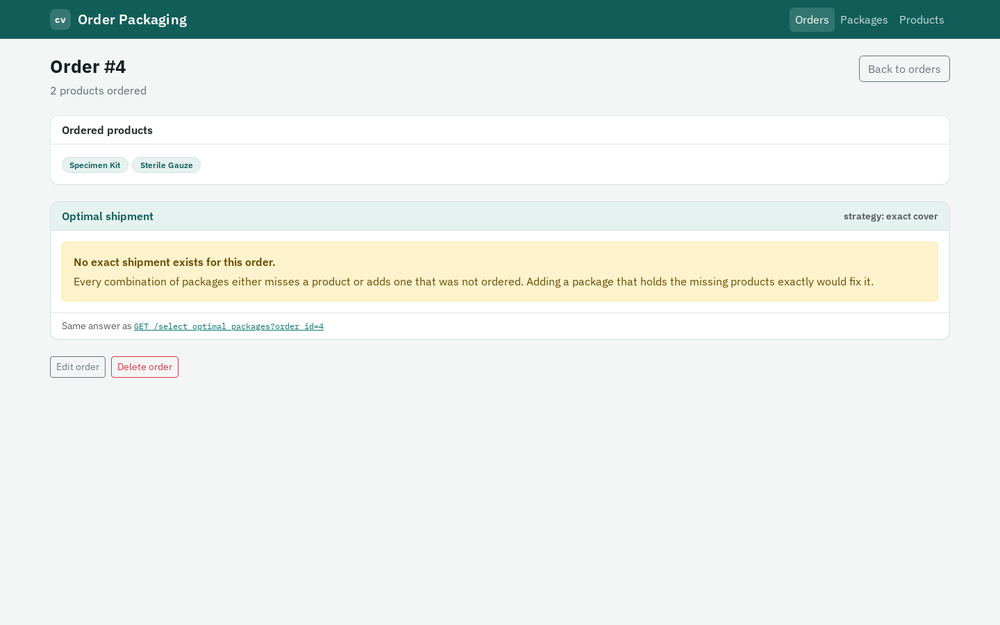
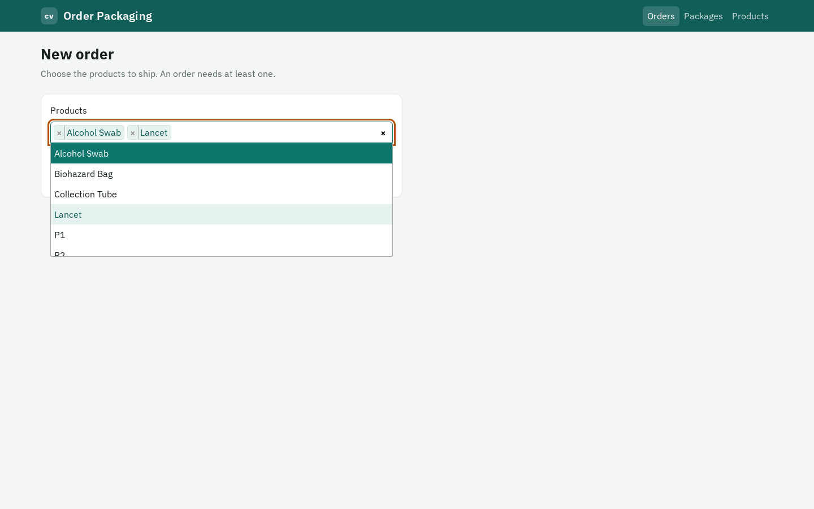
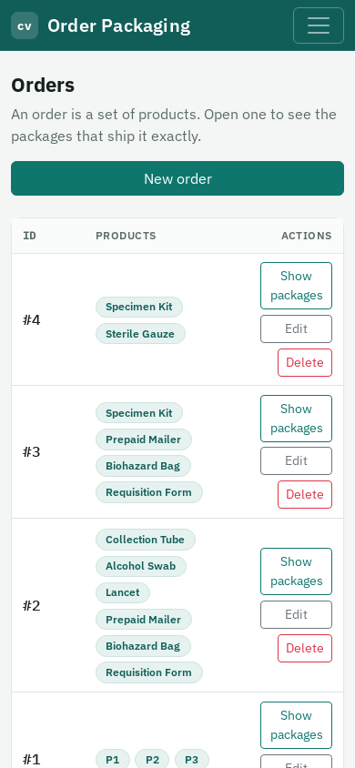
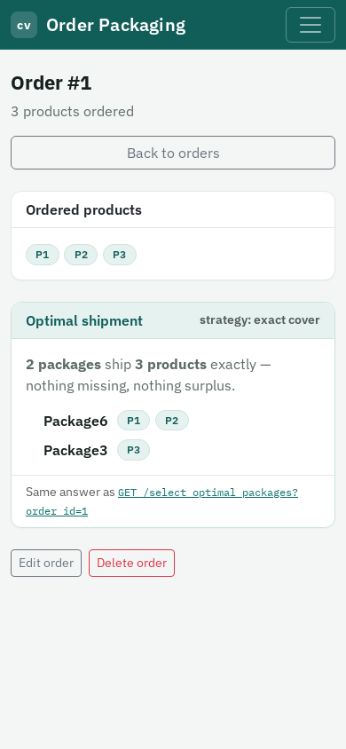
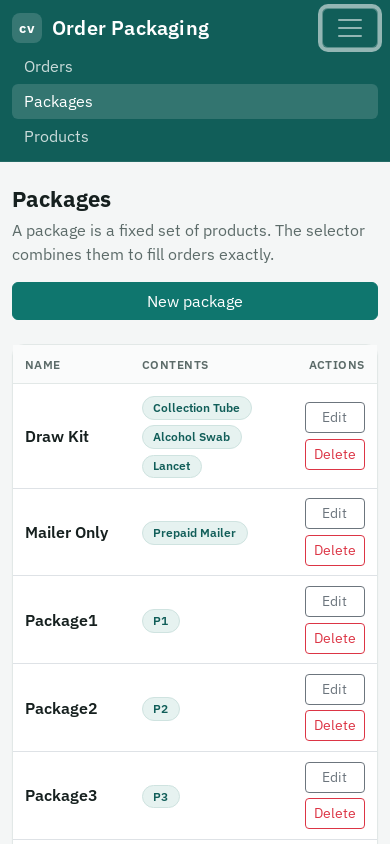
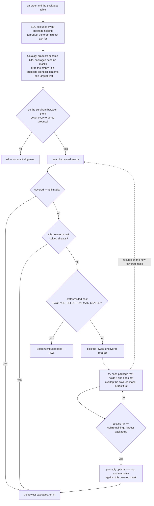
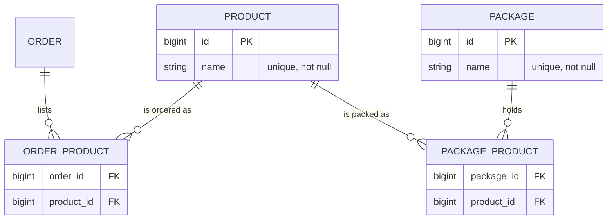

# Order Packaging

Given an **order** — a set of products — and a catalogue of **packages**, each holding a fixed
set of products, find the **smallest set of packages whose combined contents are exactly that
order**: every ordered product shipped once, nothing surplus in the box.

That is minimum-cardinality *exact cover*. It is NP-hard, it is the graded deliverable, and it
is what most of this README is about. Around it sits a Rails 8.1 CRUD UI for products, packages
and orders, plus one JSON endpoint that answers the question for a given order.

The example from the brief, which is also the seed data:

| Package  | Contents       |
| -------- | -------------- |
| Package1 | P1             |
| Package2 | P2             |
| Package3 | P3             |
| Package4 | P1, P2, P3, P4 |
| Package5 | P1, P3, P5     |
| Package6 | P1, P2         |

For an order of `P1, P2, P3` the answer is **Package6 + Package3** — two packages, not the
three of `Package1 + Package2 + Package3`. `Package4` covers the whole order in one box and is
still rejected, because it would also ship `P4`.

## Running it

```shell
docker compose up --build        # http://localhost:8180, already seeded
docker compose run --rm test     # the spec suite, in the same image
docker compose down -v           # stop, and drop the database volume
```

Compose starts PostgreSQL, waits for it, runs `db:prepare` and an idempotent `db:seed`, then boots
Puma. Host ports are **8180** (app) and **8181** (PostgreSQL). The seed data is the worked example
above plus a small clinical-supplies catalogue with three more orders, one of which deliberately
has no exact shipment. The image is a three-stage build on Ruby 3.4 and Debian bookworm — Node 24,
Yarn and `build-essential` stay in the builder, the runtime carries only `libpq5` and
`postgresql-client` and runs as a non-root `rails` user. `curl localhost:8180/health` answers
`{"status":"ok","database":"ok"}` once it is up.

Without Docker, this needs Ruby 3.4 (`.ruby-version`), Node 24 (`.nvmrc`), Yarn 1 and PostgreSQL:

```shell
bundle install
yarn install
cp .env.example .env             # then edit DB_USERNAME / DB_PASSWORD
bin/rails db:setup               # create, load schema, seed
yarn build                       # bundle app/javascript; `yarn build --watch` while editing
bin/rails server

bin/rails db:test:prepare                      # also rebuilds the JavaScript bundle
bundle exec rspec                              # 187 examples
bin/lint                                       # rubocop + rubocop-rails
bundle exec rake package_selection:benchmark   # timings across catalogue sizes
bundle exec rake package_selection:states      # states visited as orders grow
bundle exec rake package_selection:hard        # the adversarial case
```

The test database is built from `db/schema.rb` (`bin/rails db:test:prepare` refreshes it). Do
**not** run `db:seed` against it — some specs create packages that share the seed data's names.

## What it looks like

Captured from the seeded Compose stack with Playwright, at 1440×900 and 390×844.

| The order page, with its computed shipment | The package catalogue |
| --- | --- |
|  |  |

| The orders list, with its shipment modal | An order that has no exact shipment |
| --- | --- |
|  |  |

Building an order with the product picker:



| Orders on a phone | An order on a phone | Navigation on a phone |
| --- | --- | --- |
|  |  |  |

The front end is deliberately small: server-rendered ERB with Bootstrap 5, bundled by esbuild
through `jsbundling-rails` into `app/assets/builds` and served by Sprockets. The only JavaScript
is the select2 product picker and the modal that calls the JSON endpoint; deleting works as a
plain form without it.

## The search

The first implementation enumerated subsets of the **catalogue**: recursive backtracking over
package index positions, no memoisation, `Array#include?` and `Array#-` at every node. That is
Θ(2^P) for P packages, and it re-solved identical sub-problems constantly — two different package
sets that cover the same products leave behind exactly the same remaining problem.

So the state space is flipped. What matters is not *which packages have been picked* but *which
products are already covered*, and the search runs over covered-product bitmasks:



Five things do the work, in `PackageSelection::Catalog` and `Strategies::ExactCover`:

1. **Filter first.** A package holding a product the order did not ask for can never appear in an
   exact shipment, so `Catalog` drops those, plus empty packages and duplicate contents. The same
   rule is pushed into SQL, so those rows never leave PostgreSQL.
2. **Bitmask everything.** Products become bits, packages become integers, and "does this
   package fit alongside what I have already picked?" is one `AND`.
3. **Branch on the lowest uncovered product.** Every exact cover has to cover it somehow, so
   trying only the packages containing it loses no solutions while collapsing the branching factor
   from "every package" to "packages holding this one product" — Knuth's Algorithm X, in essence.
4. **Memoise by covered-mask**, so each distinct sub-problem is solved once.
5. **Prune with a counting bound.** k remaining products need at least ⌈k / largest package⌉
   packages, so when the best solution so far reaches that bound it is provably optimal and the
   branch stops. Candidates sort largest-first so good solutions turn up early enough to bite.

**Complexity: O(2ⁿ · P) time and O(2ⁿ) memo entries in the worst case**, where n is the number
of distinct products *on the order* and P the packages that survive filtering. The old version was
exponential in the size of the whole catalogue; this one is exponential only in the size of the
order, which is the small number — and in practice reaches a small fraction of those states,
because only unions of disjoint packages are reachable. NP-hard means the worst case cannot be
removed, only bounded: `PACKAGE_SELECTION_MAX_STATES` (default 200,000) caps the sub-problems one
request may visit, past which the search raises `SearchLimitExceeded` and the endpoint answers
`422` rather than holding a Puma thread.

### Measured, not asserted

`bundle exec rake package_selection:benchmark`, inside the Docker image (Ruby 3.4) on an
M-series laptop:

```
case                     order  packages       kept   packages  exact cover  brute force
------------------------------------------------------------------------------------------
the brief's example          3         7          4          1       0.0 ms       0.2 ms
a small warehouse            8        42         23          2       0.0 ms          n/a
a real catalogue            12       203         75          3       0.1 ms          n/a
a big catalogue             16      1004        262          4       0.3 ms          n/a
a very big catalogue        20      5005        811          5       1.0 ms          n/a
a silly catalogue           24     20006       1930          6       2.7 ms          n/a
```

`kept` is how many packages survive filtering, `packages` the size of the answer. Brute force runs
only when 2^kept is finishable — past ~20 surviving packages it is an oracle, not a tool.

Growth against the size of the *order* is the more interesting axis (`rake
package_selection:states`): on realistic catalogues the counting bound is tight enough that the
search never backtracks, visiting exactly one state per package in the answer. A 28-product order
over 507 packages, 179 surviving the filter, is solved in **7 states**.

The honest worst case is `rake package_selection:hard` — every package holds exactly two
products, so an exact shipment is a perfect matching, and with an odd number of products there
is none, which the search has to *prove*:

```
  order  packages  states visited         time
-----------------------------------------------
      7        21              21       0.0 ms
      9        36              55       0.1 ms
     11        55             144       0.3 ms
     13        78             377       0.9 ms
     15       105             987       2.6 ms
     17       136            2584       7.4 ms
     19       171            6765      22.0 ms
     21       210           17711      64.9 ms
```

Exponential, as it must be, but at roughly φⁿ rather than 2ⁿ. The state counts are deterministic and
the task reproduces them exactly; the times are from the same Docker run.

## Two solvers, one contract

`Strategies::BruteForce` is the naive reading of the brief — try every subset, smallest first,
return the first whose contents are exactly the order. It is correct by construction, it is
registered as a real strategy rather than hidden in a spec, and the suite **runs both solvers
against 400 randomised catalogues** (plus ten built to be solvable), asserting that they agree on
whether a shipment exists and on how many packages it takes, and that every shipment returned is
genuinely exact. Most of those 400 have no answer at all, the case most likely to be got wrong.

The seam both live behind is `PackageSelection::Registry`. "Fewest packages" is one reading of a
shipping problem; a warehouse soon wants "cheapest", "fewest touches", or a heuristic trading
optimality for a hard latency bound. Same in, same out, different middle — a strategy, not a flag:

```ruby
class CheapestShipment < PackageSelection::Strategies::Base
  def call = ... # catalog.candidates, catalog.full_mask, catalog.candidates_by_bit
end
PackageSelection::Registry.register(:cheapest, CheapestShipment)
```

`PACKAGE_SELECTION_STRATEGY=cheapest` or `ShipmentForOrder.call(order, strategy: :cheapest)` picks
it up; the shared spec `"a package selection strategy"` is the contract it must satisfy.

## Edge cases, and what they do

| Case | Behaviour |
| --- | --- |
| No exact shipment exists | `nil`, a 404 from the endpoint, an explanation on the order page. Surplus is never shipped to manufacture an answer. |
| Several minimal shipments tie | One is chosen deterministically — candidates sort largest-first, ties broken by name, so the same input always gives the same answer. |
| A product appears in no package | Caught by `Catalog#coverable?` before the search starts; returns `nil` immediately. |
| The same product listed twice on an order | Collapsed to one, and a composite unique index prevents it at the database level. |
| An order too large to solve synchronously | `SearchLimitExceeded` → `422` with a clear message, rather than a hung request. |

## The JSON endpoint

`GET /select_optimal_packages?order_id=<id>`

| Status | Body | When |
| --- | --- | --- |
| `200` | `{"shipment_packages":["Package6","Package3"]}` | solved |
| `404` | `{"error":"Order not found"}` | no such order, or no `order_id` at all |
| `404` | `{"error":"No valid packages found"}` | nothing ships the order exactly |
| `422` | `{"error":"Order is too large to package synchronously"}` | the search hit its work budget |

Controllers are thin: find a record, call one object, render. `OrdersController#show` renders the
same answer server-side, and the orders index uses this endpoint to fill a modal.

## Products, packages, orders



An order has no attributes of its own beyond timestamps — it *is* a set of products, and it is
invalid when empty. Both join tables carry foreign keys and a composite unique index on the pair,
subsuming the single-column index each shipped with; deleting an order, package or product removes
its join rows and leaves the other side intact.

## Where things live

```
app/services/package_selector.rb        facade: order + packages -> package names
app/services/package_selection/
  catalog.rb              normalisation, filtering, bitmasks
  candidate.rb            one package as (name, mask, product_count)
  registry.rb             the strategy seam
  shipment_for_order.rb   the ActiveRecord adapter, and the cache
  strategies/             base · exact_cover · brute_force
app/controllers/concerns/paginatable.rb LIMIT/OFFSET for the three index pages
lib/catalog_builder.rb    randomised catalogues for the specs and the rake benchmarks
```

Dependencies point inward: `PackageSelection::*` and `PackageSelector` are plain Ruby with no
ActiveRecord, no Rails and no clock, which is what makes the two strategies property-testable
against each other. `ShipmentForOrder` is the one object allowed to know both worlds — it turns
rows into arrays, calls the domain, and caches under a SHA-256 digest of the exact inputs, so
re-opening an order is free and an edit to either side yields a different key, not a stale answer.
(`test/` is the empty Minitest scaffolding from `rails new`; RSpec is the framework here.)

## Configuration

The two variables specific to this app:

| Variable | Default | What it does |
| --- | --- | --- |
| `PACKAGE_SELECTION_STRATEGY` | `exact_cover` | Which registered strategy answers by default (`exact_cover` or `brute_force`). |
| `PACKAGE_SELECTION_MAX_STATES` | `200000` | Sub-problems the search may visit before giving up with a 422. |

The rest are optional and listed in `.env.example`: the PostgreSQL connection (`DB_HOST`, empty
locally for a Unix socket and `db` under Compose, plus `DB_PORT`, `DB_USERNAME`, `DB_PASSWORD`,
`DB_NAME`, `TEST_DB_NAME`), `RAILS_MAX_THREADS` for Puma threads and the ActiveRecord pool,
`SECRET_KEY_BASE` (needed in production), `SKIP_DB_SETUP` to skip migrate-and-seed in the
container entrypoint, and `RAILS_SERVE_STATIC_FILES` / `RAILS_LOG_TO_STDOUT`, set in the image.

## What the original code got wrong

Four bugs, each reproduced against the original code before being fixed:

- **Deleting any real order raised `ActiveRecord::InvalidForeignKey`** — `has_many
  :order_products` had no `dependent:` option while the schema declares the foreign key, so the
  Delete button 500'd for every order with products, which is all of them. Same for deleting a
  product that appeared in any package.
- **The catch-all 404 route could never fire.** `match '*path', to: 'application#not_found'`
  pointed at a method under `private`, and Rails only dispatches to public instance methods, so
  unknown URLs raised `AbstractController::ActionNotFound` instead of rendering `public/404.html`.
- **`ActiveRecord::RecordNotFound` was unhandled for the HTML controllers** — `/orders/999999`
  raised rather than 404ing; only the JSON controller had its own rescue.
- **`Order` had no validations,** so `@order.save` always succeeded and the error branch of
  `OrdersController#create` / `#update` was dead code, while the multi-select's `required`
  attribute was client-side only.

Alongside those, the N+1 in `Package.all.map { |p| p.products.pluck(:name) }` became one join query,
the index pages gained `includes` and pagination, and the join tables gained the unique indexes.

## Known gaps

- **No authentication or authorisation.** Every route is public.
- **The shipment is recomputed, never stored.** Packages and orders are both editable, so an
  order does not snapshot the shipment it was quoted; a real system would persist the chosen
  shipment at fulfilment time.
- **The cache is per-process.** `:memory_store` in production means each Puma worker keeps its
  own copy; a multi-process deployment wants Memcached or Redis.
- **Large orders are refused, not queued.** Past the work budget the right answer is a background
  job writing the result back to the order, which is outside the exercise.
- **Quantities are not modelled.** An order is a *set*: the same product cannot be ordered twice,
  and packages hold one of each — the brief is stated that way and the bitmask representation
  depends on it. There is no cost or weight either, so "smallest set" counts packages only.
- **select2 still needs jQuery.** It is the only reason jQuery is in the bundle (pinned to 3.x,
  which select2 4.1 is built against); a jQuery-free picker would cut most of the 260 KB bundle.

## Licence

MIT, see [LICENSE](LICENSE).
